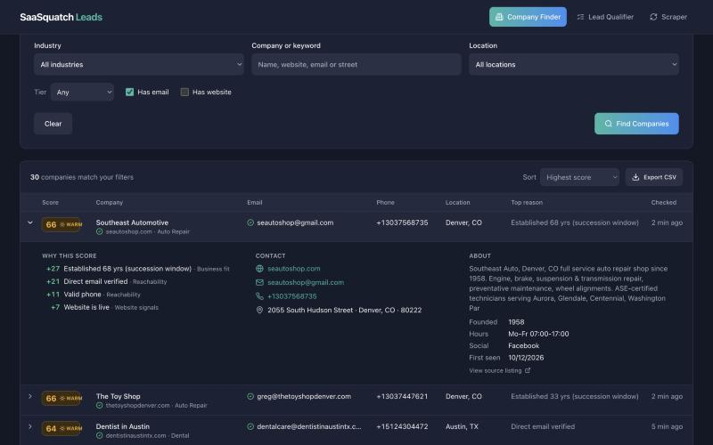
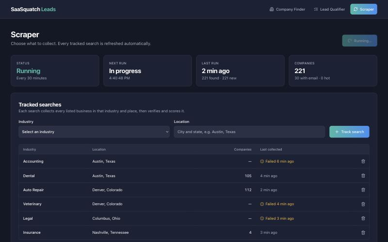
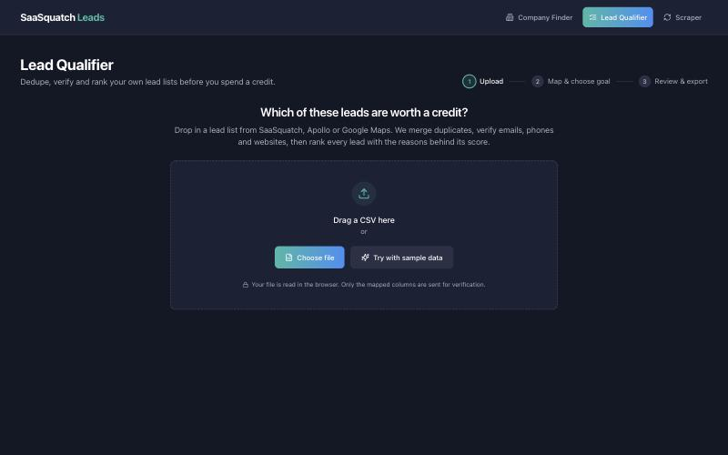

# SaaSquatch Leads: Company Finder and Lead Qualifier

**Find companies, verify how to reach them, and know which ones deserve a credit and a call.**

Two tools share one pipeline:

- **Company Finder** is a company database that fills itself. A scraper collects businesses by industry and location, checks each company's website and email, scores it, and refreshes everything **every 30 minutes**. You search, filter and export from the UI or the API.
- **Lead Qualifier** does the same cleanup for a list you already have. Upload a CSV from SaaSquatch, Apollo, Crunchbase or Google Maps and get it back deduplicated, verified and ranked.



| Scraper: tracked searches and run history | Lead Qualifier: upload your own list |
|---|---|
|  |  |

## What the pipeline does

1. **Collect** *(Company Finder)*: every named business for an industry in a city, from OpenStreetMap: name, website, phone, email, address, opening hours and founding date. Branches of national chains are left out.
2. **Merge duplicates**, using fuzzy company-name matching plus shared domain, phone or email.
3. **Verify contact data**: email syntax, typo'd domains (`gmial.com`), disposable and no-reply inboxes, generic inboxes (`info@`), MX records, email/website domain mismatch, and phone validity with E.164 formatting.
4. **Enrich** from the company's own homepage and contact page (robots.txt respected): published email and phone, title, description, social presence, last copyright year, "since 19xx" founding signals, and hiring signals.
5. **Score every company 0–100** with an itemised **"why this score"** breakdown:
   - **ETA Searcher:** established, owner-run SMBs in search-fund revenue range ($1–20M), with succession signals.
   - **B2B Sales:** reachable decision makers at growing, mid-market companies.
6. **Export** a clean CSV, or from Lead Qualifier a **HubSpot-ready import file**.

## Why this feature

SaaSquatch charges per enriched lead ($19 for 50, $49 for 125), so every duplicate or dead contact wastes money. Its users, mainly acquisition searchers and SDRs, need to know *which* leads to spend credits and calls on, and *why*. Lead Qualifier sits next to "Validators" in the existing app nav and closes that gap. On the bundled sample, it turns 35 messy rows into 30 unique leads, catches 6 bad contact details, and flags 10 credits you can skip.

The full product reasoning, UX decisions and architecture are in **[docs/ARCHITECTURE.md](docs/ARCHITECTURE.md)**.

## Quick start

```bash
git clone <this repo> && cd lead-qualifier
npm install
npm run dev            # http://localhost:3000
```

No database or API keys are needed. Without `DATABASE_URL`, companies, saved lists and the lookup cache live in memory and are lost on restart. The first scrape starts about 10 seconds after the server does.

### Run with Docker (app + Postgres)

```bash
docker compose up --build      # http://localhost:3000
docker compose down            # stop (add -v to also delete saved lists)
```

This builds a slim Node 20 image (Next.js standalone output; tests run during the build) and starts it next to Postgres 16. Companies, tracked searches, run history, saved lists and the 7-day lookup cache persist in the `pgdata` volume. If port 3000 is taken, change the host port in `docker-compose.yml` (for example `"3001:3000"`). To run the app container alone, in memory, use `docker build -t lead-qualifier . && docker run -p 3000:3000 lead-qualifier`.

### Optional: persist to any Postgres

```bash
cp .env.example .env.local
# DATABASE_URL=postgres://...neon.tech/neondb?sslmode=require
npm run dev            # tables are created automatically on first use
```

### Tests

```bash
npm test               # 36 tests: pipeline, scraper parsing, contact extraction, API filters (Vitest)
npm run typecheck
```

## The scraper

| | |
|---|---|
| **Source** | [OpenStreetMap](https://www.openstreetmap.org/copyright) through the public Nominatim and Overpass APIs. It is open data (ODbL) and both services permit automated use within their usage policies. |
| **Schedule** | One run about 10 seconds after the server starts, then every 30 minutes (`SCRAPE_INTERVAL_MINUTES`). Runs never overlap. |
| **What it collects** | Every *tracked search* (an industry plus a place). Six are created on first start; add or remove them on the **Scraper** page or through `/api/searches`. |
| **When a source is busy** | The public Overpass servers are shared and sometimes answer 429/504 or time out. Each search tries two endpoints, up to three times. A search that still fails is listed with its error in the run history, keeps the companies it already has, and goes first on the next run. |
| **Politeness** | One Overpass query at a time with a pause between searches, an honest user agent, `robots.txt` honoured, one website fetch per domain per 7 days. |

Seventeen industries are supported out of the box (`src/lib/scraper/industries.ts`); adding one is a single line mapping a label to OpenStreetMap tags.

### Configuration

| Variable | Default | Purpose |
|---|---|---|
| `DATABASE_URL` | *(unset: in memory)* | Postgres connection string. Tables are created automatically. |
| `SCRAPE_INTERVAL_MINUTES` | `30` | Minutes between scheduled runs (minimum 5). |
| `SCRAPER_ENABLED` | `1` | Set to `0` to switch off the built-in schedule (runs can still be started by hand or by an external cron). |
| `SCRAPER_SEARCHES` | six US searches | Searches created on first start, as `industry@place; industry@place`. Empty creates none. |
| `OFFLINE_CHECKS` | *(unset)* | Set to `1` to skip live DNS and website checks (CI, offline work). |

## API

Everything the UI shows comes from these routes, so the same data is available to a CRM, Zapier or a notebook:

```bash
# Hot and warm plumbing companies in Austin that publish an email, best first
curl 'http://localhost:3000/api/companies?industry=Plumbing&city=Austin&minScore=40&hasEmail=1'

# The same search as a CSV download
curl -OJ 'http://localhost:3000/api/companies?industry=Plumbing&city=Austin&format=csv'

# Track a new search, then collect it now instead of waiting for the schedule
curl -X POST http://localhost:3000/api/searches -H 'content-type: application/json' -d '{"industry":"plumbing","location":"Austin, Texas"}'
curl -X POST http://localhost:3000/api/scraper/run
```

| Endpoint | Purpose |
|---|---|
| `GET /api/companies` | Search the company database. Filters: `q`, `industry`, `city`, `tier`, `minScore`, `hasEmail`, `hasWebsite`. `sort` = `score` \| `recent` \| `name`. Paginated with `page` and `limit` (max 100). `format=csv` downloads every match (max 5,000). |
| `GET /api/companies/:id` | One company with its score breakdown and website details. |
| `GET /api/companies/facets` | Totals, and the industries and cities present, with counts. |
| `GET /api/searches`, `POST /api/searches`, `DELETE /api/searches/:id` | List, add and remove tracked searches. Also returns the supported industries. |
| `GET /api/scraper/status` | Whether a run is in progress, next run time, totals and the last 20 runs. |
| `POST /api/scraper/run` | Start a run now (`202`). Add `?wait=1` to hold the response until it finishes. |
| `POST /api/qualify` | Rows in, scored leads and stats out (≤ 500 rows per call). Columns are auto-mapped. |
| `POST /api/check` | Network checks only (MX, homepage) for ≤ 100 leads. Used by the UI in batches of 50. |
| `GET/POST /api/runs`, `GET /api/runs/:id` | List, save and reload qualified lists. |

`./examples/api-demo.sh` qualifies the sample dataset through `POST /api/qualify` and prints the top targets.

The API has no authentication. Run it on a private network, or put it behind your own gateway before exposing it.

## Stack

TypeScript · Next.js 14 (App Router) · React 18 · Tailwind CSS · shadcn/ui-style components · lucide icons · PapaParse · libphonenumber-js · cheerio · lru-cache · PostgreSQL 16 with Drizzle ORM · Docker · Vitest · GitHub Actions · Render (API, scraper, database) · Vercel (UI).

## Deploying

The app is split across two hosts, each doing what it is good at:

| Host | Serves | Why |
|---|---|---|
| **Render** (Docker web service + Postgres) | The API, the database and the 30-minute scraper | The scraper needs a process that stays alive and a database next to it. |
| **Vercel** | The web pages | Fast static hosting on a CDN, with a preview URL for every pull request. It forwards every `/api` call to Render. |

**1. Render (backend).** Push the repository to GitHub. In Render choose **New → Blueprint** and select the repository: `render.yaml` creates the web service from the `Dockerfile` and a Postgres 16 database, and wires `DATABASE_URL` between them. When it is live, note the service URL (`https://<name>.onrender.com`) and check `https://<name>.onrender.com/api/scraper/status`.

**2. Vercel (frontend).** Import the same repository in Vercel. Add one environment variable **before the first build**: `BACKEND_URL=https://<name>.onrender.com`. No database variable is needed on Vercel. Changing `BACKEND_URL` later needs a redeploy, because the forwarding rule is fixed at build time.

**3. Keep the schedule running on a free plan.** Render's free web service sleeps when it gets no traffic, and the in-app timer sleeps with it. `.github/workflows/scrape.yml` calls `POST /api/scraper/run` every 30 minutes, which wakes the service and starts a run. Turn it on by adding the repository variable `BACKEND_URL` (GitHub → Settings → Secrets and variables → Actions → Variables). On a paid, always-on Render plan the in-app timer is enough and the workflow is optional.

Things to know before sharing the link: the API has no authentication, so anyone with the URL can add or remove tracked searches; the first request after the backend has been asleep can take up to a minute; and Render's free Postgres is time-limited, so check its expiry date in the Render dashboard.

## Dataset

`public/sample-leads.csv` is a **fictional** dataset of 35 rows (generated by `scripts/make_sample.py`) that mimics a messy multi-source export. It contains planted duplicates, typo'd and disposable emails, generic inboxes and dead websites. When you use **Try with sample data**, network checks are simulated from fixtures because the domains are not real. The UI labels these results as simulated. Real uploads use live DNS and HTTP checks.

## Ethics and privacy

- CSVs are parsed in the browser, and only the mapped fields are sent to the server.
- Company listings come from OpenStreetMap, which is open data. Nothing is scraped from sites whose terms forbid it, no logins are used and no CAPTCHAs or rate limits are bypassed.
- The only pages fetched from a company are its own homepage and, when the homepage shows no email, its contact page: with an honest user agent, `robots.txt` honoured, and one fetch per domain per 7 days.
- Only business contact details the company itself publishes are stored. No personal social profiles are scraped and no third-party enrichment APIs receive your contacts.
- Every company links back to its source listing, and exports carry the source URL.

## Project layout

```
src/
  app/                  Next.js pages (/, /qualifier, /scraper) + API route handlers
  instrumentation.ts    starts the 30-minute scrape schedule when the server boots
  components/           UI (AppShell, CompanyFinder, ScraperPanel, upload, mapping, review table)
  lib/scraper/          OpenStreetMap collector, contact extraction, run orchestration, storage, query filters
  lib/pipeline/         normalize → dedupe → validate → score (pure, shared by client and server)
  lib/network.ts        MX + homepage checks (server only)
  lib/cache.ts          L1 LRU + L2 Postgres lookup cache
  lib/db/               Drizzle schema + storage (Postgres or in-memory)
tests/                  Vitest suite
docs/                   Architecture write-up and screenshots
```
