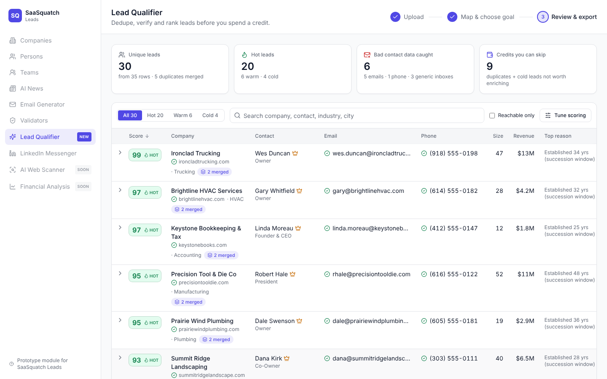
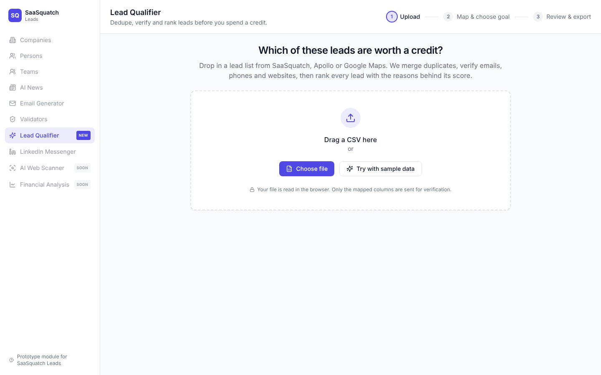
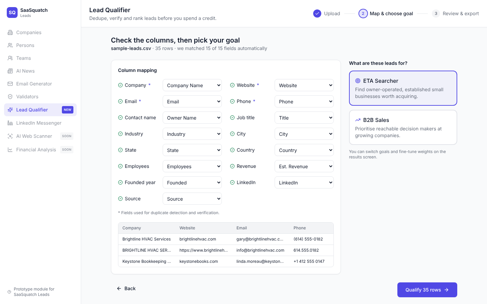
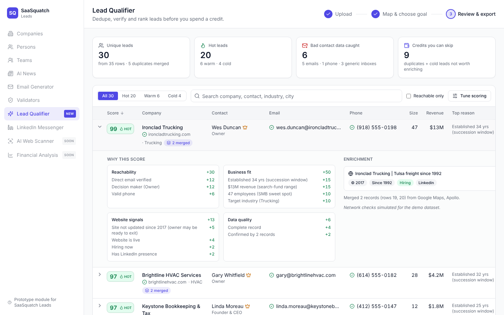

# Lead Qualifier: a SaaSquatch Leads module

**SaaSquatch finds leads. Lead Qualifier decides which ones deserve a credit and a call.**

Upload any lead list (a SaaSquatch, Apollo, Crunchbase or Google Maps export, or your own CSV) and Lead Qualifier will:

1. **Merge duplicates** across sources, using fuzzy company-name matching plus shared domain, phone or email.
2. **Verify contact data**: email syntax, typo'd domains (`gmial.com`), disposable and no-reply inboxes, generic inboxes (`info@`), MX records, email/website domain mismatch, and phone validity with E.164 formatting.
3. **Enrich lightly** from the company's own homepage (robots.txt respected): title, description, social presence, last copyright year, "since 19xx" founding signals, and hiring signals.
4. **Score every lead 0–100** against your goal, with an itemised **"why this score"** breakdown:
   - **ETA Searcher:** established, owner-run SMBs in search-fund revenue range ($1–20M), with succession signals.
   - **B2B Sales:** reachable decision makers at growing, mid-market companies.
5. **Export** a clean CSV or a **HubSpot-ready import file** (lead status, lifecycle stage and score reasons pre-filled).



| Upload | Map & choose goal | Why this score |
|---|---|---|
|  |  |  |

## Why this feature

SaaSquatch charges per enriched lead ($19 for 50, $49 for 125), so every duplicate or dead contact wastes money. Its users, mainly acquisition searchers and SDRs, need to know *which* leads to spend credits and calls on, and *why*. Lead Qualifier sits next to "Validators" in the existing app nav and closes that gap. On the bundled sample, it turns 35 messy rows into 30 unique leads, catches 6 bad contact details, and flags 10 credits you can skip.

The full product reasoning, UX decisions and architecture are in **[docs/ARCHITECTURE.md](docs/ARCHITECTURE.md)**.

## Quick start

```bash
git clone <this repo> && cd lead-qualifier
npm install
npm run dev            # http://localhost:3000, then click "Try with sample data"
```

No database or API keys are needed. Without `DATABASE_URL`, saved lists and the lookup cache live in memory.

### Optional: persist to Postgres (Neon)

```bash
cp .env.example .env.local
# DATABASE_URL=postgres://...neon.tech/neondb?sslmode=require
npm run dev            # tables are created automatically on first use
```

### Tests

```bash
npm test               # 21 unit + end-to-end pipeline tests (Vitest)
npm run typecheck
```

## API

The whole pipeline is also available as one HTTP call, for CRMs, Zapier or notebooks:

```bash
curl -X POST http://localhost:3000/api/qualify \
  -H 'content-type: application/json' \
  -d '{"preset":"eta","rows":[{"Company Name":"Brightline HVAC","Website":"brightlinehvac.com","Email":"gary@brightlinehvac.com","Phone":"(614) 555-0182","Title":"Owner","Employees":"28","Est. Revenue":"$4.2M","Founded":"1994"}]}'
```

Or run `./examples/api-demo.sh` to qualify the sample dataset and print the top targets.

| Endpoint | Purpose |
|---|---|
| `POST /api/qualify` | Rows in, scored leads and stats out (≤ 500 rows per call). Columns are auto-mapped. |
| `POST /api/check` | Network checks only (MX, homepage) for ≤ 100 leads. Used by the UI in batches of 50. |
| `GET/POST /api/runs`, `GET /api/runs/:id` | List, save and reload qualified lists. |

## Stack

TypeScript · Next.js 14 (App Router) · React 18 · Tailwind CSS · shadcn/ui-style components · lucide icons · PapaParse · libphonenumber-js · cheerio · lru-cache · PostgreSQL (Neon) with Drizzle ORM · Vitest · GitHub Actions · Vercel (AWS us-east-1).

## Deploying

1. Push to GitHub and import the repo in Vercel. No build settings are needed, and `vercel.json` pins the region to `iad1`.
2. *(Optional)* Create a Neon database in AWS us-east-1 and add `DATABASE_URL` to Vercel env vars.
3. Every PR gets a preview URL, and merging to `main` deploys to production. CI runs typecheck, tests and build.

## Dataset

`public/sample-leads.csv` is a **fictional** dataset of 35 rows (generated by `scripts/make_sample.py`) that mimics a messy multi-source export. It contains planted duplicates, typo'd and disposable emails, generic inboxes and dead websites. When you use **Try with sample data**, network checks are simulated from fixtures because the domains are not real. The UI labels these results as simulated. Real uploads use live DNS and HTTP checks.

## Ethics and privacy

- CSVs are parsed in the browser, and only the mapped fields are sent to the server.
- The only page fetched is the company's own homepage, with an honest user agent, `robots.txt` honoured, and one request per domain (cached for 7 days).
- No personal social profiles are scraped and no third-party enrichment APIs receive your contacts.

## Project layout

```
src/
  app/                  Next.js pages + API route handlers
  components/           UI (AppShell, upload, mapping, review table, score badges)
  lib/pipeline/         normalize → dedupe → validate → score (pure, shared by client and server)
  lib/network.ts        MX + homepage checks (server only)
  lib/cache.ts          L1 LRU + L2 Postgres lookup cache
  lib/db/               Drizzle schema + storage (Postgres or in-memory)
tests/                  Vitest suite
docs/                   Architecture write-up and screenshots
```
